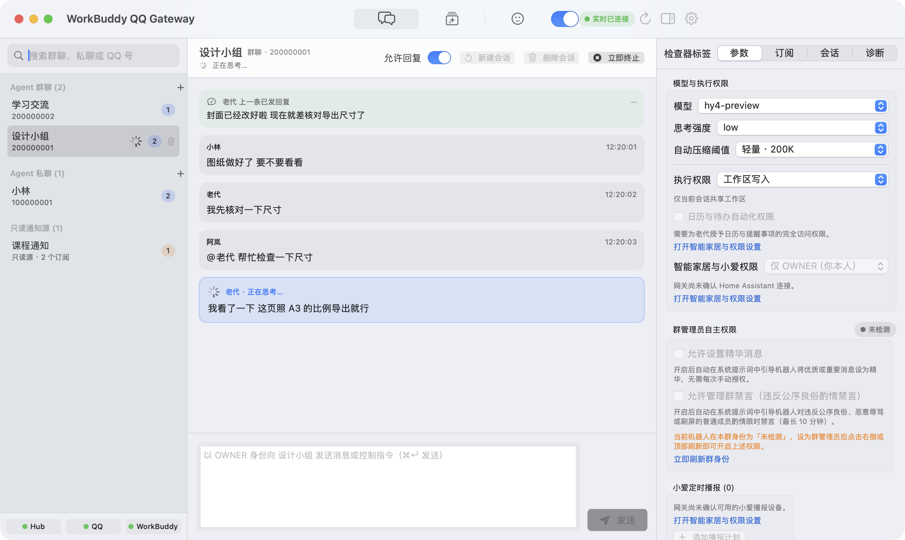
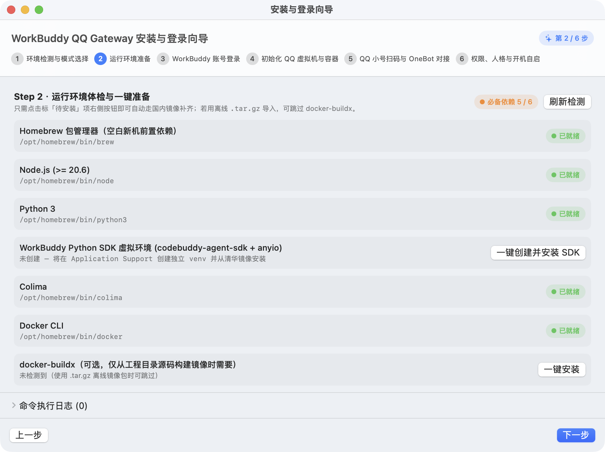
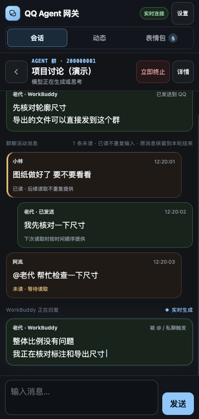

<a href="README.md">简体中文</a> · <strong>English</strong>

<h1 align="center"></h1>

Manage WorkBuddy in a native SwiftUI app for Mac. Bring it into QQ groups and direct messages to join conversations, handle files, and summarize notices.

<a href="https://github.com/DrivingGodJ/workbuddy-qq-agent-gateway/releases/latest"><strong>Download for Mac</strong></a> · <a href="docs/GUIDE.en.md">Setup and deployment</a> · macOS 14+ · Apple Silicon

## Native macOS workspace

Switch between groups, DMs, and notification sources in the sidebar. Follow incoming messages and live output in the main window. Use the inspector to change a conversation’s model, reasoning effort, and permissions, or pause replies and stop a running task.

<table>
<tr>
<td width="50%"> <strong>Setup assistant</strong> · Check dependencies and sign in to WorkBuddy and QQ.</td>
<td width="50%"> <strong>Native settings</strong> · Manage the persona, background-task model, LAN panel, and system permissions.</td>
</tr>
</table>

*Screenshots show the v0.3.0 SwiftUI interface in Chinese with synthetic demo data. Click an image to see it full size.*

## Install

1. Download the Apple Silicon `arm64.pkg` installer from [GitHub Releases](https://github.com/DrivingGodJ/workbuddy-qq-agent-gateway/releases/latest).
2. Open **WorkBuddy QQ Gateway** from Applications. Follow the assistant to prepare the runtime and sign in to WorkBuddy and the bot’s QQ account.
3. Add the groups or DMs you want to connect, and set the model and tool permissions for each conversation.

The assistant can detect and take over an existing deployment. The app supports starting at login, a quiet GitHub update check at launch, and persona import and export. See the [setup and deployment guide](docs/GUIDE.en.md) for installation and migration details.

## What it can do in QQ

| Feature | How it works |
| --- | --- |
| **Handle tasks in groups and DMs** | Each conversation keeps its own context by default. The agent can read merged forwards and images, then send text, files, images, and native QQ stickers. |
| **Route notices to the right conversations** | Subscribe groups or DMs to read-only sources. The gateway batches and summarizes notices, delivers them to each subscriber, and shows delivery progress. |
| **Manage stickers and persona** | Search the sticker collection, edit descriptions, and manage the blacklist. Import or export the shared persona used across conversations. |
| **Enable tools where you need them** | Grant access to Calendar, Reminders, and smart home controls per conversation. Home Assistant, XiaoAI announcements, and Qzone features depend on local configuration and the QQ bridge. |

Open the LAN panel on your phone

Enable the LAN panel in the Mac app’s settings to view conversation status on a phone connected to the same network. Run <code>npm run demo</code> from the source checkout to try the web panel without QQ sign-in or model calls. See the <a href="docs/GUIDE.en.md">setup and deployment guide</a>.

## Documentation

- [Full feature and configuration reference (Chinese)](docs/readme-reference.zh-CN.md) · [Architecture](docs/architecture.png)
- [Permissions and security](SECURITY.md) · [Home Assistant](docs/HOME_ASSISTANT.md) · [Local customization](docs/LOCAL_CUSTOMIZATION.md)
- [Virtual machine deployment](docs/MACOS_VM_DEPLOYMENT.md) · [Report an issue](https://github.com/DrivingGodJ/workbuddy-qq-agent-gateway/issues)

This project is independently maintained for WorkBuddy. Third-party services and bundled persona material are subject to their own terms. See the [attribution notice](persona/QQ-BRIDGE-NOTICE.txt).
