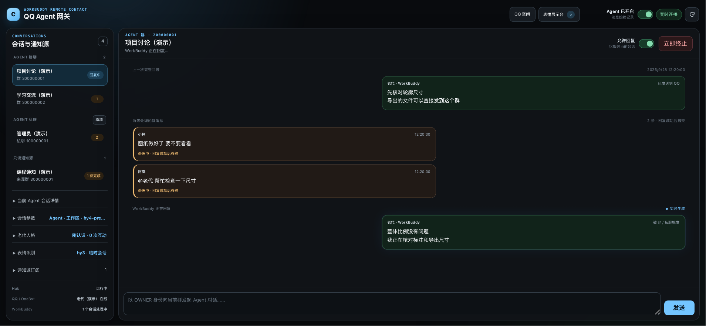
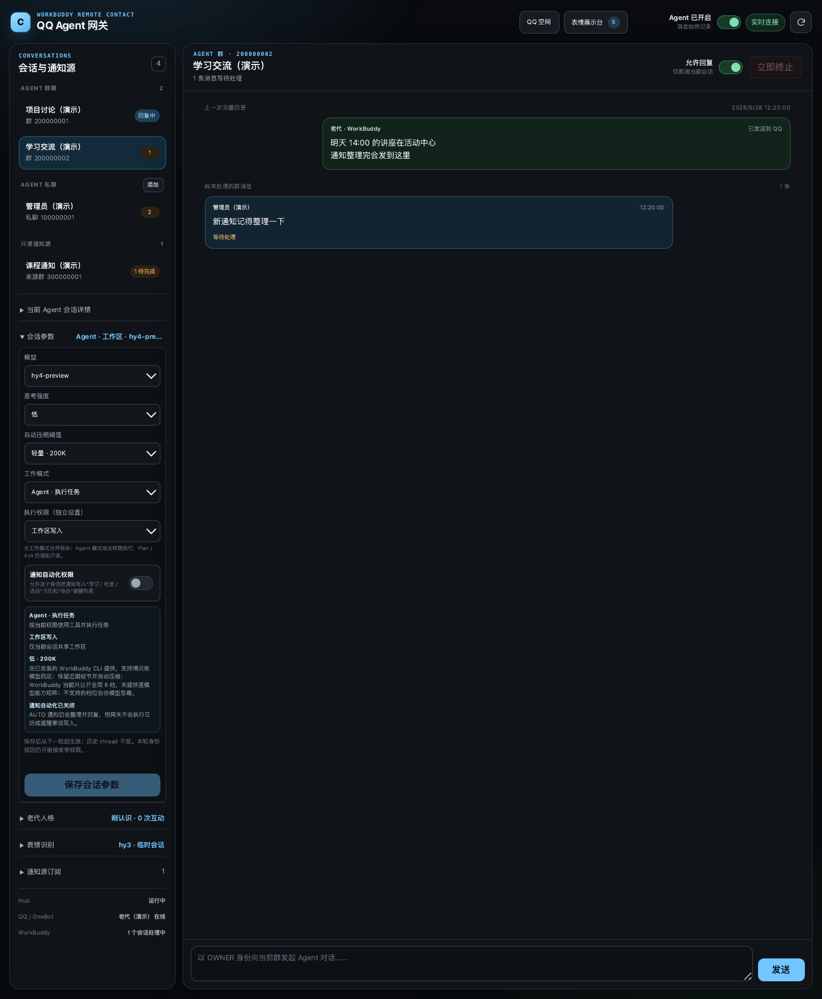
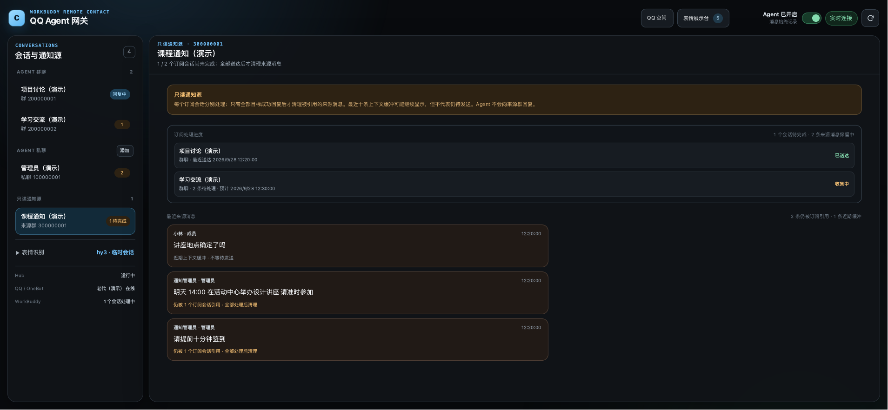
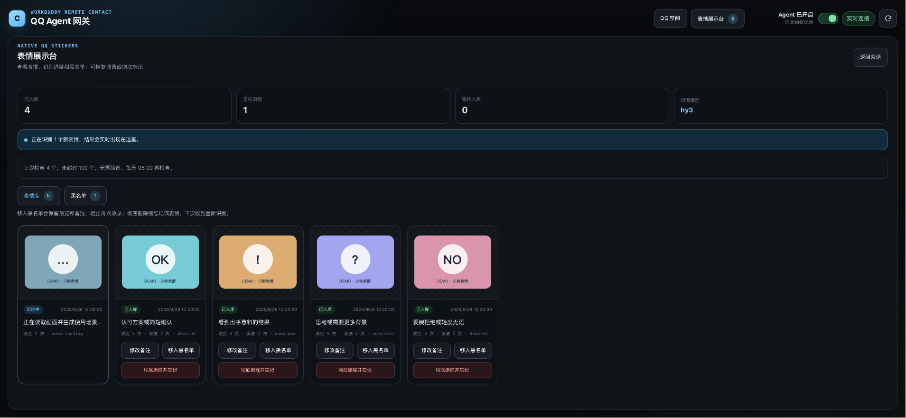

[简体中文](README.md) | **English**

# WorkBuddy QQ Agent Gateway

Bring a local WorkBuddy Agent into everyday QQ conversations. Connect messages, files and tool actions in groups and private chats, and see what the Agent is doing through a web console.

## Keep the conversation and its context

Each group and private chat has a persistent session by default and continues after restarts. The Agent can read current conversation messages, expand forwards, inspect images and send text, files, images and native stickers. Explicit links can also let a private chat share a group's context.

## Follow progress and stay in control

Watch live output, pending messages and queues, then adjust models and execution permissions per session. Pause replies or stop a task directly in the interface instead of mixing control commands into chat.

## Follow important notifications without watching every group

Subscribe a destination to read-only notification sources, collect messages within a waiting window and summarize them for each intended recipient. The console shows subscriber progress; notifications retain explicit destinations.

## Keep the expression in the conversation

Search stickers, edit their usage labels and manage a blacklist. Optional integrations add Home Assistant, Apple Calendar/Reminders, XiaoAI announcements and Qzone features under separate permissions.

*All images show the real frontend with synthetic demo data, not real QQ conversations.*

## Install or try the local demo

### Option A: Apple Silicon macOS Desktop App (Recommended)

Download **`WorkBuddyQQGateway-0.3.0-arm64.pkg`** from [GitHub Releases](https://github.com/DrivingGodJ/workbuddy-qq-agent-gateway/releases), install it into `/Applications`, and follow the 6-step onboarding wizard:

- **Guided setup & non-destructive takeover**: automatically detects existing deployments or sets up Colima + SnowLuma, macOS Keychain credentials, and login startup;
- **Full native desktop & web console**: manage group/private sessions, add private chats from your QQ friend list, toggle autonomous group admin permissions (essence messages / moderation mutes), configure Home Assistant & XiaoAI scheduled greetings, curate stickers, and enable the LAN control panel;
- **Persona backup & selective uninstall**: import/export `.laodai-persona.json` personas, with options to remove only the SnowLuma container/image or the full VM.

### Option B: Local demo from source (no QQ or model usage)

A local demo requires neither QQ login nor model calls, so you can explore the console first.

[Demo and deployment guide](docs/GUIDE.en.md)

## Explore further

| Topic | Documentation |
| --- | --- |
| Local demo, requirements and deployment | [User guide](docs/GUIDE.en.md) |
| Sessions, subscriptions, shared context and automation | [Full reference (Chinese)](docs/readme-reference.zh-CN.md) |
| Permissions, data and security | [Security](SECURITY.md) |
| Local customization and home integration | [Customization](docs/LOCAL_CUSTOMIZATION.md) · [Home Assistant](docs/HOME_ASSISTANT.md) |
| Downloads and feedback | [Releases](https://github.com/DrivingGodJ/workbuddy-qq-agent-gateway/releases) · [Issues](https://github.com/DrivingGodJ/workbuddy-qq-agent-gateway/issues) |

Independently built and maintained around WorkBuddy. Follow [Security](SECURITY.md) and the terms of the third-party tools and services you connect (QQ, WorkBuddy, Home Assistant, etc.).
