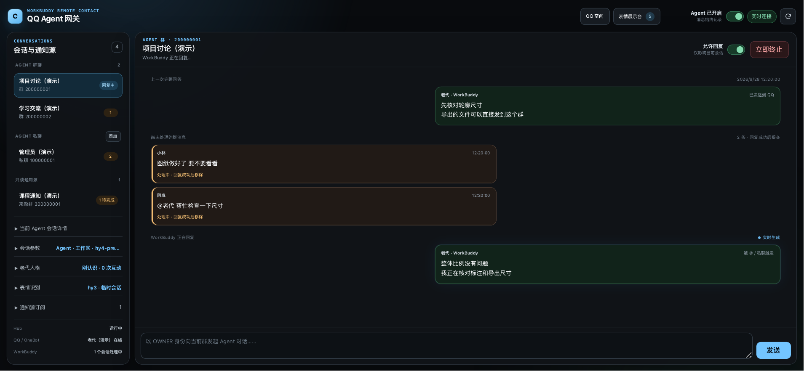
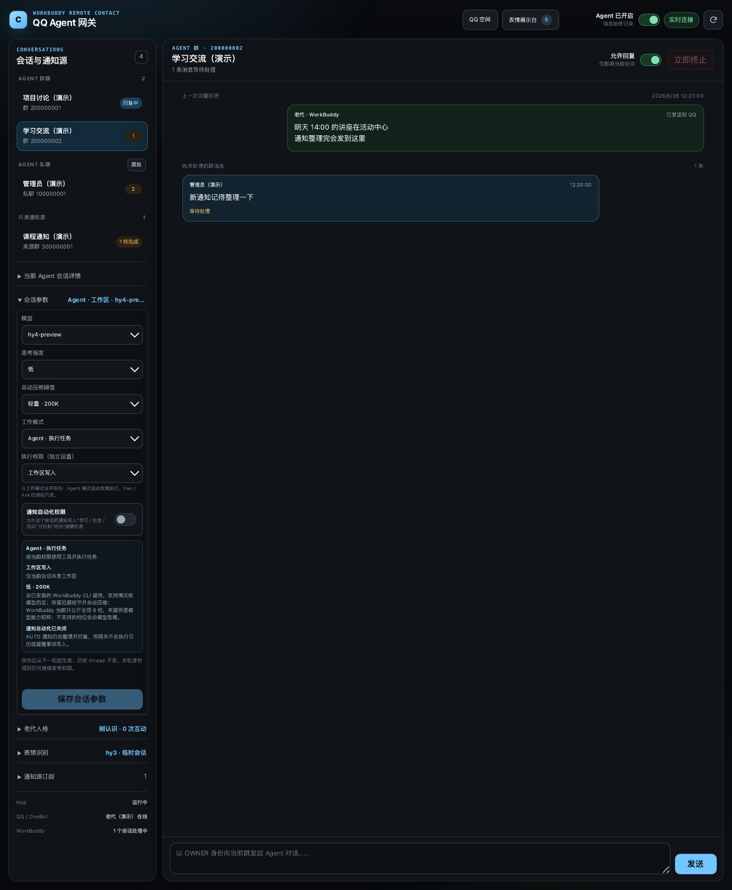
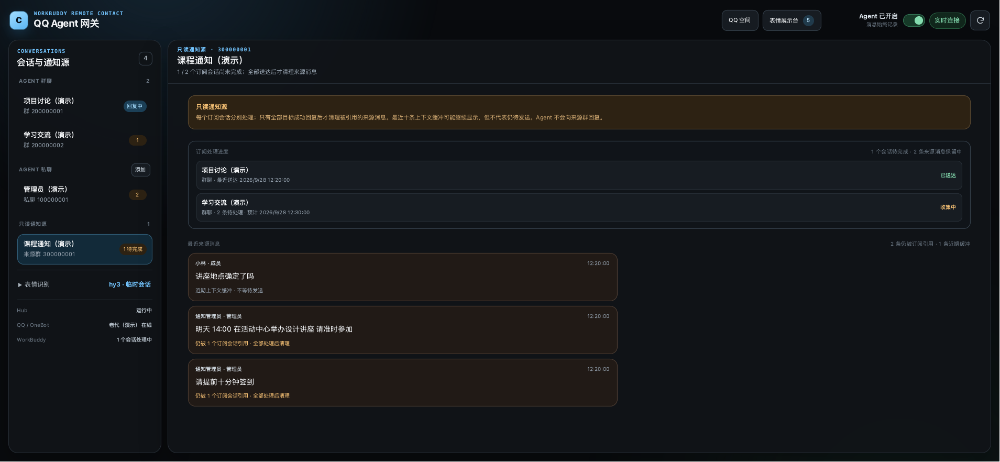
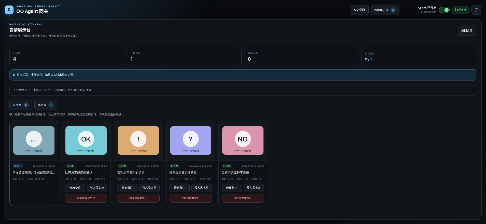

**简体中文** | [English](README.en.md)

# WorkBuddy QQ Agent 网关

让本机 WorkBuddy Agent 进入 QQ 的日常对话：接住群聊和私聊里的任务，把消息、文件与工具操作连起来，在网页里看见它正在做什么。

## 对话可以继续，任务也有来处

每个群和私聊默认保留自己的持久会话，重启后继续。Agent 可以按当前对话读取消息、展开转发、查看图片，再发送文字、文件、图片和原生表情。需要时，也可明确让私聊关联某个群的上下文。

## 看得见进展，也能随时控制

在面板查看实时输出、待处理消息和队列，调整会话模型与执行权限。想暂停回复或中断当前任务时，直接在界面操作，不必把控制命令混进群消息。

## 重要通知，不必每个群都盯着

为目标会话订阅只读通知来源，按等待窗口汇总，再分别发给需要的人。面板显示各订阅者的处理进度；通知仍有目标，不会变成无差别群发。

## 也保留聊天里的表情与习惯

表情库可以检索、修改场景和整理黑名单。需要扩展时，还能按独立授权接入 Home Assistant、Apple 日历/提醒、小爱播报与 QQ 空间功能。

*以上均为真实前端配合合成演示数据，不包含实际 QQ 聊天记录。*

## 下载安装或本地预览

### 方式 A：Apple Silicon Mac 原生桌面端（推荐）

前往 [GitHub Releases](https://github.com/DrivingGodJ/workbuddy-qq-agent-gateway/releases) 下载最新安装包 **`WorkBuddyQQGateway-0.3.0-arm64.pkg`**，双击安装到「应用程序」目录后打开即可按 6 步图形化引导完成配置：

- **自动部署与接管**：检测并复用已有部署，或从零配置 Colima + SnowLuma 容器、macOS 钥匙串凭据与登录后自启；
- **完整图形控制台**：内置群聊/私聊管理、好友列表快速添加私聊、群管自主权限开关（精华消息 / 违规禁言）、智能家居与小爱定时播报、表情库管理及局域网广播面板；
- **人格导入导出与独立卸载器**：支持 `.laodai-persona.json` 人格备份导入导出，卸载时可选择仅移除 SnowLuma 容器/镜像或完整清理虚拟机。

### 方式 B：源码本地演示（无需 QQ 与模型额度）

项目提供不登录 QQ、不调用模型的本地演示，适合先看看网页控制台与交互：

[打开演示与源码部署指南](docs/GUIDE.zh-CN.md)

## 进一步了解

| 想了解什么 | 去哪里看 |
| --- | --- |
| 下载与使用、环境要求、源码部署 | [使用指南](docs/GUIDE.zh-CN.md) |
| 会话、订阅、共享上下文和自动化 | [完整功能参考](docs/readme-reference.zh-CN.md) |
| 权限、数据与安全 | [安全说明](SECURITY.md) |
| 本地修改与家居集成 | [定制结构](docs/LOCAL_CUSTOMIZATION.md) · [Home Assistant](docs/HOME_ASSISTANT.md) |
| 问题反馈与下载安装包 | [Releases](https://github.com/DrivingGodJ/workbuddy-qq-agent-gateway/releases) · [Issues](https://github.com/DrivingGodJ/workbuddy-qq-agent-gateway/issues) |

围绕 WorkBuddy 独立设计与维护。使用与扩展请遵守 [安全说明](SECURITY.md) 及所接入第三方服务（QQ、WorkBuddy、Home Assistant 等）的各自条款。
