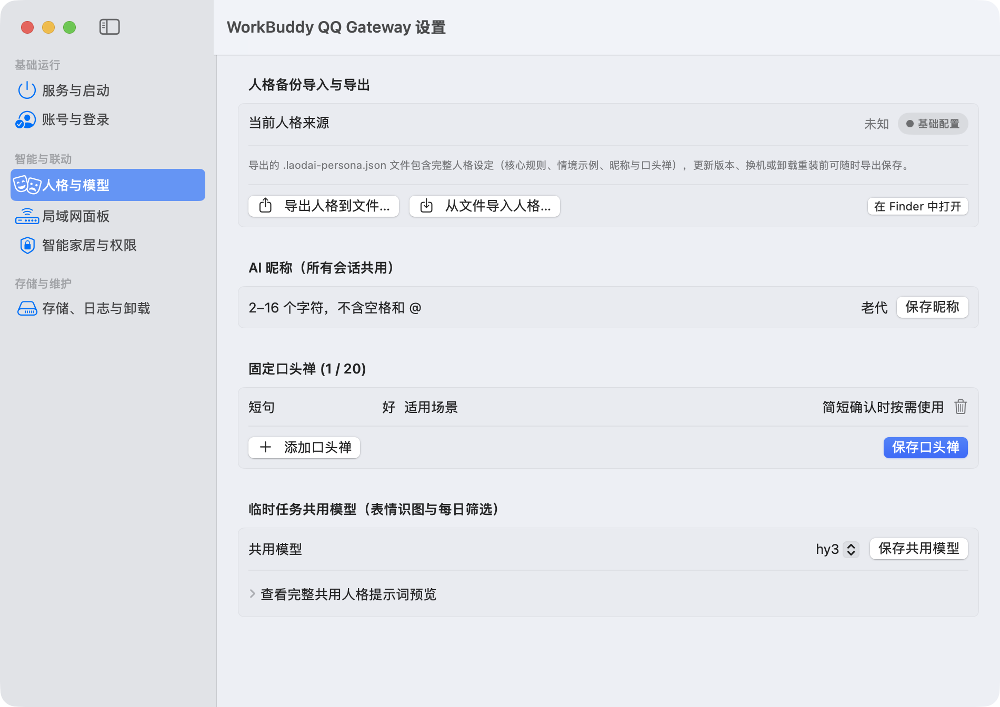

<strong>简体中文</strong> · <a href="README.en.md">English</a>

<h1 align="center"></h1>

在 Mac 上用原生 SwiftUI 应用管理 WorkBuddy，让它在 QQ 群聊和私聊里接话、处理文件、整理通知。

<a href="https://github.com/DrivingGodJ/workbuddy-qq-agent-gateway/releases/latest"><strong>下载安装包</strong></a> · <a href="docs/GUIDE.zh-CN.md">使用与部署指南</a> · <a href="docs/PERSONA_GUIDE.md"><strong>人格指南与文件规范</strong></a> · macOS 14+ · Apple Silicon

## macOS 原生工作台

在侧栏切换群聊、私聊和通知来源，实时看消息与生成进度。在右侧调整当前会话的模型、思考强度和权限，随时暂停回复或终止任务。

<table>
<tr>
<td width="50%"> <strong>安装向导</strong> · 检查运行环境，引导登录 WorkBuddy 和 QQ。</td>
<td width="50%"> <strong>原生设置</strong> · 管理人格、临时任务模型、局域网面板与系统权限。</td>
</tr>
</table>

*截图来自 v0.3.0 的 SwiftUI 界面，使用合成演示数据。点击可查看大图。*

## 安装

1. 在 [GitHub Releases](https://github.com/DrivingGodJ/workbuddy-qq-agent-gateway/releases/latest) 下载 Apple Silicon 的 `arm64.pkg` 安装包。
2. 安装后从「应用程序」打开 **WorkBuddy QQ Gateway**，按向导准备运行环境，登录 WorkBuddy 和机器人 QQ 账号。
3. 添加要接入的群聊或私聊，按会话配置模型与工具权限。

已有部署可通过向导检测并接管。应用支持登录后自启、启动时静默检查 GitHub 新版本，以及导入和导出人格。安装和迁移细节见 [使用与部署指南](docs/GUIDE.zh-CN.md)。

## 在 QQ 里能做什么

| 功能 | 使用方式 |
| --- | --- |
| **接住群聊和私聊里的任务** | 每个会话默认保留独立上下文。Agent 可以读取合并转发和图片，也可以发送文字、文件、图片和 QQ 原生表情。 |
| **把重要通知送到对应会话** | 给群聊或私聊订阅只读来源。按收集窗口汇总通知，逐个送达，面板显示每个订阅者的处理进度。 |
| **整理表情与聊天习惯** | 浏览和搜索表情库，编辑使用场景，管理黑名单。人格可导入、导出，供不同会话共同使用（详见 [人格指南与文件规范](docs/PERSONA_GUIDE.md)）。 |
| **按需开放工具** | 按会话为日历、提醒事项与智能家居授权。支持 Home Assistant、小爱音箱播报和 QQ 空间，具体能力取决于本机配置和 QQ 桥接。 |

从手机访问局域网面板

在 Mac 应用的设置里开启局域网面板，手机即可在同一局域网内访问并查看会话状态。也可以在源码目录运行 `npm run demo` 体验网页面板，演示无需登录 QQ 或调用模型。完整步骤见 <a href="docs/GUIDE.zh-CN.md">使用与部署指南</a>。

## 文档

- **[人格指南与文件规范](docs/PERSONA_GUIDE.md)**（自定义人格 JSON 规范、模板与导入导出教程）
- [完整功能与配置参考](docs/readme-reference.zh-CN.md) · [架构图](docs/architecture.png)
- [权限与安全](SECURITY.md) · [Home Assistant](docs/HOME_ASSISTANT.md) · [本地定制](docs/LOCAL_CUSTOMIZATION.md)
- [虚拟机部署](docs/MACOS_VM_DEPLOYMENT.md) · [问题反馈](https://github.com/DrivingGodJ/workbuddy-qq-agent-gateway/issues)

本项目围绕 WorkBuddy 独立维护。第三方服务及内置人格素材各有适用条款。详见 [素材来源说明](persona/QQ-BRIDGE-NOTICE.txt)。
